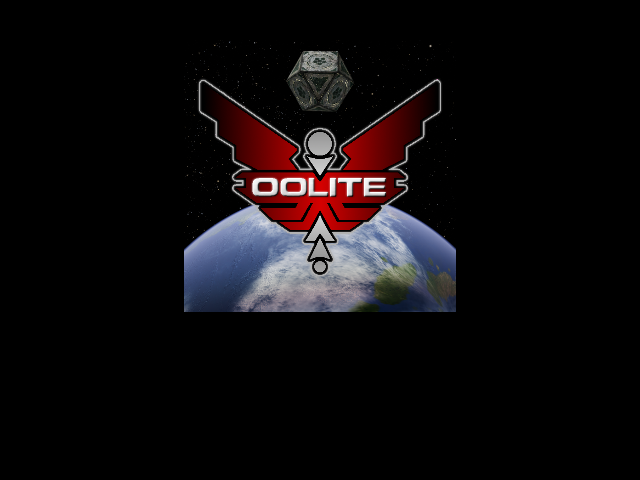

# Genuine Oolite native guest display screenshot — AC090 68040

18 November 2026, 15:35 UTC. This is a **framebuffer readback of the real SDL3 renderer executing in the dedicated AmigaChrome AC090 AmigaOS 3.2.3 guest**. It is not an illustration, mocked screenshot, or unmodified asset image. The 640x480 native SDL3 preview window displays the original pinned Oolite 768x768 `Resources/Images/splash.bmp` as a scaled texture.



`tests/oolite_native_splash_view.c` now optionally accepts a second command-line filename for rendered-frame capture. At frame 10 it calls `SDL_RenderReadPixels(renderer,NULL)` and `SDL_SaveBMP` on the resulting actual render surface. The guest wrote `SYS:Oolite/screens/splash-render.bmp` in the dedicated lab; host converted the real BMP into lossless 640x480 PNG, SHA-256 `d22b5c973677b956bf6f0452d2c580aa289afc3d266a5c0a427b1779b9afc364`. The PNG contains 19,844 distinct colors. Raw guest console evidence is `tests/evidence/oolite-native-splash-capture-guest.log`:

```
OOLITE_CAPTURE_BEGIN
OOLITE_SPLASH SOURCE=SYS:Oolite/Resources/Images/splash.bmp WIDTH=768 HEIGHT=768
OOLITE_SPLASH CAPTURED=SYS:Oolite/screens/splash-render.bmp
OOLITE_SPLASH status=PASS frames=240
OOLITE_CAPTURE_RC 0
OOLITE_CAPTURE_END
```

The test builds against the canonical GFOpenGPU SDL3 headers/stub, loads `LIBS:GFOpenGPU/SDL3.module` and runs on native 68040. Screenshot is a **standalone branded preview** and not Oolite's own title menu, player ship or 3D scene. No full game application link or gameplay is claimed. Original native engine source currently has 41 tested ObjC translation units but still needs complete source closure, JS/ObjC runtime linkage and original startup.
